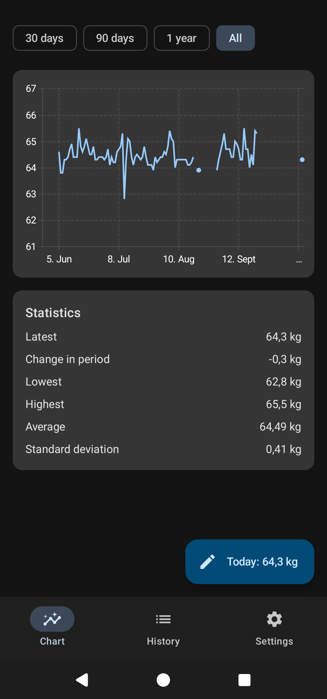
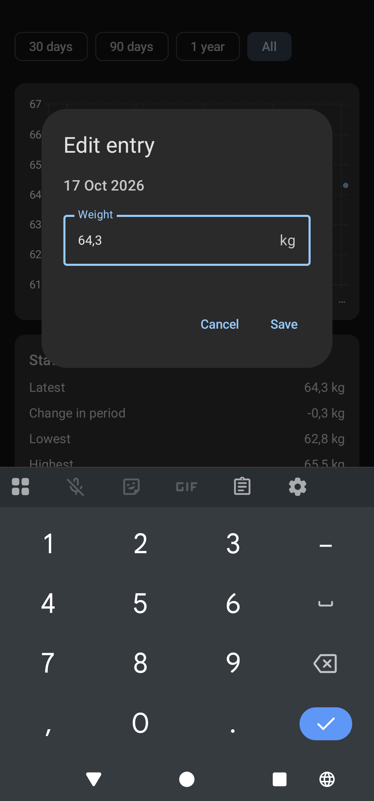

# weighter

A simple, private Android app for tracking your daily body weight. Log one weight per day, see your progress on a chart, and keep your data safe with CSV export and automatic monthly backups to your own Nextcloud.

No accounts, no ads, no third-party cloud. Your data stays on your phone and on your own server.

## Screenshots

<p>
  
  &nbsp;&nbsp;
  
</p>

## Features

- **Daily weight logging.** One entry per day, in kg. Entering a weight again for the same day replaces the previous one.
- **Chart as the home screen.** A line chart of your weight over time, with range filters (30 days, 90 days, All). Days without an entry leave a gap in the line instead of being interpolated.
- **Quick entry.** A floating button on the chart opens the entry dialog with the keyboard already up.
- **History.** A list of all entries, with editing and deleting.
- **CSV export and import.** Save your full history to a file or share it, and restore it later. Imports accept days with an empty weight (e.g. `2026-08-19,`).
- **Nextcloud backup.** Connect your Nextcloud with an app password and back up manually with one tap.
- **Automatic monthly backups.** Once a month, the app uploads your complete history to Nextcloud in the background, even when the app is closed. If the phone is offline, the backup runs the next time it has internet.
- **Dark mode**, including a dark startup screen.

## Tech stack

- **Kotlin** and **Jetpack Compose** (Material 3)
- **Room** for local storage (SQLite)
- **Vico** for charts
- **WorkManager** for scheduled background backups
- **OkHttp** for WebDAV requests to Nextcloud
- **DataStore** for settings
- **Android Keystore** for encrypting the stored Nextcloud password

Minimum Android version: **8.0 (API 26)**.

## Architecture

The app follows a layered structure where the UI never touches the database directly:

```
UI (Compose screens)
      │
ViewModels
      │
WeightRepository  ── the single entry point to data
      │
Room (DAO + database)
```

Backups are built on top of the same repository:

```
MonthlyBackupWorker (WorkManager, runs daily, needs internet)
      │  "has a backup succeeded this month?"
BackupManager ── builds the CSV, uploads it, records the result
   │        │
   │   NextcloudClient ── WebDAV: test connection, create folders, upload
   │
BackupSettingsStore ── connection settings and last backup status (DataStore)
   │
SecretCipher ── encrypts the app password with the Android Keystore
```

## Nextcloud backups

Backups are uploaded over WebDAV to:

```
<your Nextcloud>/myapps/weighter/backups/
```

One file is kept per month (for example `weighter-2026-10.csv`). Backing up again in the same month overwrites that month's file. Every file contains your **complete** history, so any single backup can restore everything through the CSV import.

Debug builds upload to `myapps/weighter/backups-debug` instead, so test data never overwrites real backups.

**Setup:**

1. In Nextcloud, go to **Settings → Security → Devices & sessions** and create an **app password** for weighter. Don't use your main password.
2. In the app, open **Settings → Nextcloud backup** and enter your server address (HTTPS only), username and app password.
3. Tap **Connect**. The app tests the connection before saving it.

The app password is encrypted with the Android Keystore before it is stored, and you can revoke it in Nextcloud at any time.

## CSV format

One line per day, with an ISO date and the weight in kg:

```
2026-08-18,82.4
2026-08-19,
2026-08-20,82.1
```

An empty weight means no entry for that day.

## Building

1. Clone the repository:
   ```
   git clone https://github.com/Schnapsi93/weighter.git
   ```
2. Open the project in **Android Studio** and let Gradle sync.
3. Connect an Android phone with USB debugging enabled (or start an emulator) and press **Run**.

To run the unit tests, right-click the `test` folder and choose **Run Tests**, or run:

```
./gradlew test
```

The Room database schema for each version is stored in `app/schemas/` and is needed for migrations, so keep it committed.

## Project status

A personal project, built step by step in milestones. It's feature-complete for my own use, but feel free to fork it and adapt it to yours.
